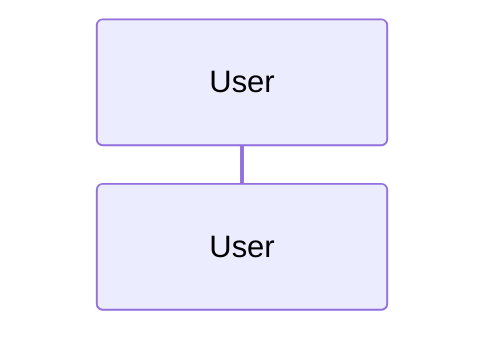

# Architecture: <title>

## Context (C4 level 1)
```mermaid
C4Context
  title System context
```

## Containers (C4 level 2)
```mermaid
C4Container
  title Containers
```
New or changed: ...

## Key flows

Failure path: ...

## State and structure (only where useful)
```mermaid
stateDiagram-v2
```

## Module boundaries
| Module | Owns | May call | Must not call |
| --- | --- | --- | --- |

## Failure modes
| Failure | Behavior | Recovery |
| --- | --- | --- |

## Decisions
| Decision | Recommended | Reason and trade-off | ADR | Hard to change later |
| --- | --- | --- | --- | --- |

## Open questions
- None (or list; any open question blocks acceptance).
