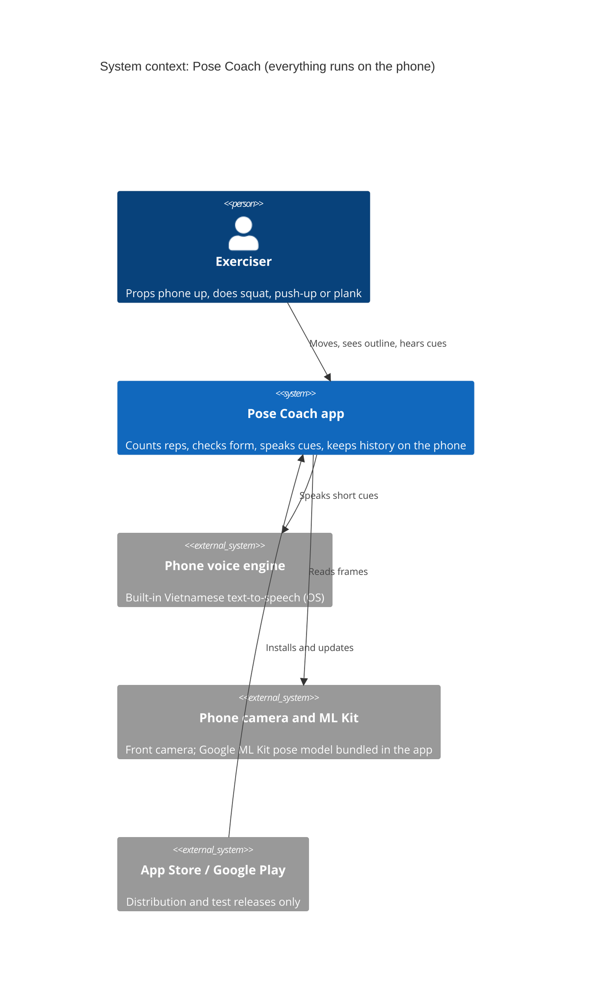
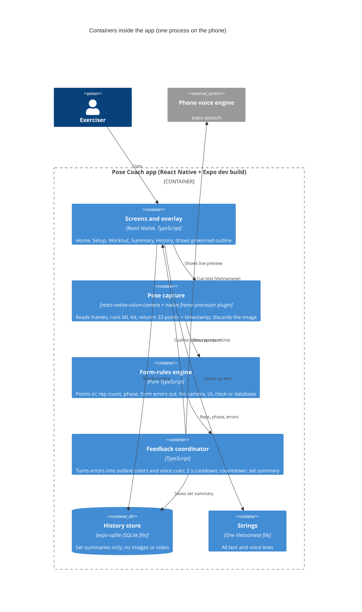
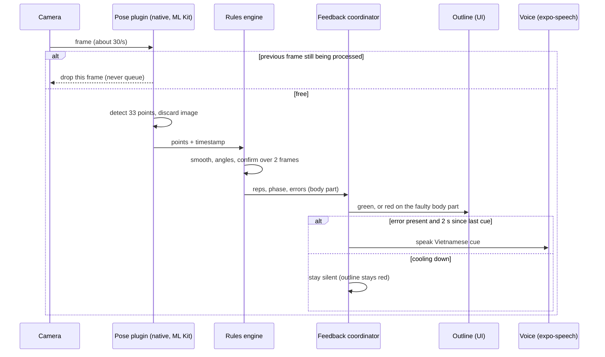
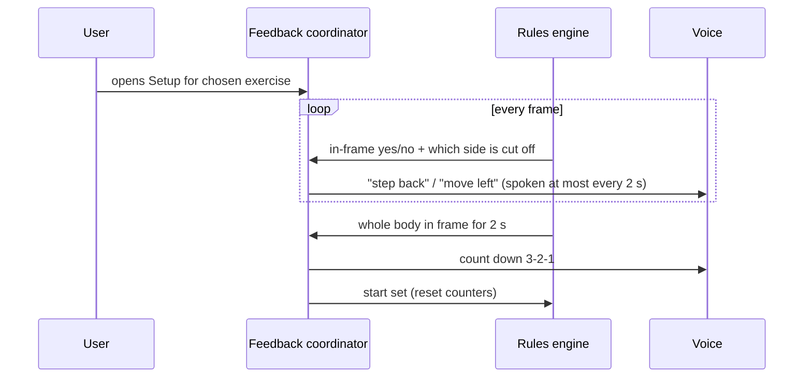
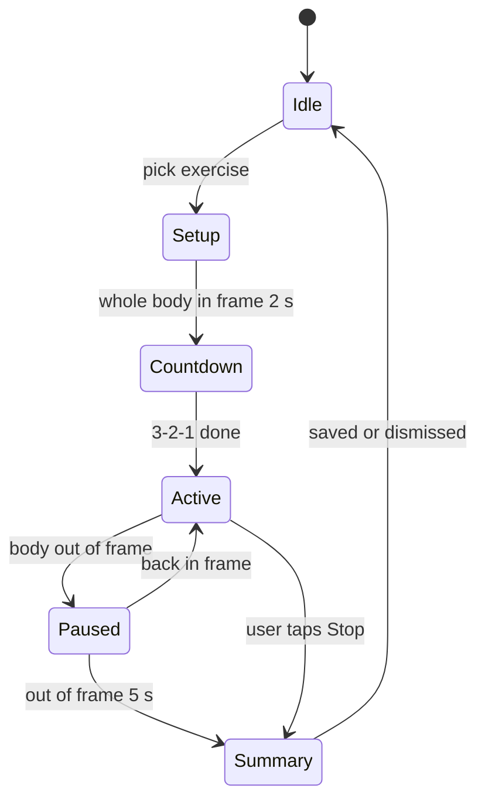

# Architecture: Pose Coach v1

Inputs: `spec.md` (R1-R16, AC1-AC12), `grill.md` (Q1-Q12, no open questions), `design.md`.
Plain-language terms: a **frame** is one camera picture; **pose points** are the 33 body points found in a frame; a **frame processor** is native code that sees each frame as it arrives; **fps** is frames per second.
The whole system is one app on one phone. There is no server, no cloud and no account.

## Context (C4 level 1)

No network call is made while the app runs (R4, AC3, AC10).

## Containers (C4 level 2)

New: everything (new product). The only "outside" parts are the OS voice engine and the on-device ML Kit model.

## Key flows

### Flow 1: live feedback loop (frame -> pose -> rules -> outline + voice)

Failure path: if confidence is low or the body is out of frame, the engine outputs "not reliable" instead of errors; the outline turns grey, no cue about form is spoken, and the "step back" prompt is used instead (see Failure modes).

### Flow 2: setup and start (R2, R3)

Failure path: body leaves the frame during the 2 s hold -> the timer restarts; set does not start.

### Flow 3: end of set -> summary -> SQLite (R12, R13)
```mermaid
sequenceDiagram
  participant U as User
  participant F as Feedback coordinator
  participant E as Rules engine
  participant S as Summary screen
  participant D as SQLite
  U->>F: taps Stop (or leaves frame for 5 s)
  F->>E: end set
  E->>F: reps or hold seconds, per-error counts, form score
  F->>S: show summary
  F->>D: INSERT one row inside a transaction
  alt write fails (disk full)
    D-->>F: error
    F->>S: keep summary on screen + "could not save" message; retry on tap
  end
  U->>S: opens History
  S->>D: SELECT newest first
```

## State and structure


## Latency and fps budget (R11, AC8)
Goal: 20 fps or more (one frame every 50 ms) and outline plus voice start within 300 ms of the movement. The two numbers are different: fps is throughput (how many frames per second are analyzed); latency is delay for one movement.

| Step | Budget (ms) | Notes |
| --- | --- | --- |
| Camera capture + delivery to plugin | 35 | Camera at 30 fps; worst case wait for next frame |
| ML Kit pose detection | 50 | The biggest cost; must fit in 50 ms to hold 20 fps. Measure on both phones first |
| Hand points to JavaScript | 10 | Send 33 x 4 numbers only, never the image |
| Rules engine (smoothing, angles) | 5 | Plain arithmetic |
| Confirmation (state must hold 2 frames) | 100 | Prevents flicker; at 20 fps = 2 frames. Deliberate cost; tune per exercise |
| Outline redraw | 20 | One screen refresh |
| Voice cue start (text-to-speech) | 60 | Voice may lag on some phones; outline is the hard 0.3 s guarantee, voice start is measured per phone |
| **Total** | **280** | 20 ms spare |

Rules: drop frames rather than queue them (a queue turns lag into permanent delay). If the measured total on a reference phone goes over 300 ms, reduce the confirmation to 1 frame for the largest errors first, or use the faster ML Kit model.

## Module boundaries
| Module | Owns | May call | Must not call |
| --- | --- | --- | --- |
| `engine` (pure TS) | Angles, smoothing, rep/phase logic, form errors, set summary maths, thresholds config | Nothing outside itself | Camera, React, Expo, SQLite, clock, network |
| `pose` (plugin) | Camera frames, ML Kit call, point format | Native ML Kit | Disk, network, JS storage (images must never leave it) |
| `coach` | Mapping errors to outline/voice, 2 s cooldown, countdown, set lifecycle | `engine`, `tts`, `storage`, `i18n` | Camera directly |
| `tts` | expo-speech wrapper, voice availability check | expo-speech | Engine |
| `storage` | SQLite open, migrations, insert/query | expo-sqlite | Engine, UI |
| `ui` | Screens, outline drawing | `coach`, `storage` (read), `i18n` | `pose` internals, hard-coded text |
| `i18n` | Vietnamese strings (English later) | Nothing | Anything |
Rule enforced by lint and an import check in tests: `engine` imports nothing from the other modules.

## Failure modes
| Failure | Behavior | Recovery |
| --- | --- | --- |
| Body out of frame | Outline grey; voice "step back"/"move left"; during a set the rep logic pauses; timer does not run | Resumes when whole body is back; set ends after 5 s out of frame |
| Low light / blurry | Many low-confidence points; message "need more light" after 3 s of low confidence | Pauses counting; resumes when confidence recovers |
| Low pose confidence (a few points) | Engine ignores rules that depend on those points; never reports an error from a point under the confidence threshold | Fewer cues rather than false cues |
| Low fps / thermal throttling (phone hot) | Detect fps under 15 for 5 s: lower camera resolution, then show "phone is hot, rest a moment"; counting accuracy flagged | Recover when fps returns; set summary notes reduced accuracy |
| TTS Vietnamese voice missing | At first launch and Setup, check installed voices; if none, show on-screen text cues and a "install Vietnamese voice" hint with the OS settings link | Cues continue as large text; app stays usable |
| Camera permission denied | Explain why in plain Vietnamese (camera is only used on the phone, nothing is recorded); button to OS settings; no workout | Re-checks permission when the app returns to the foreground |
| Frame processor crash / camera busy | Show "camera problem, restart"; no half-saved set | Set not saved unless it has at least 1 rep or 5 s hold |
| Database write fails | Summary stays on screen; retry; history untouched | See `data-model.md` |
| App sent to background mid-set | Camera stops (iOS/Android rule); set ends and is saved as partial | User starts a new set |
| Phone call / other app speaks | Voice may be cut off | Outline remains the primary feedback |

## Decisions
| Decision | Recommended | Reason and trade-off | ADR | Hard to change later |
| --- | --- | --- | --- | --- |
| App framework | React Native + Expo dev build | One codebase, Claude writes it well; needs custom build, no Expo Go | `docs/adr/0001-react-native-expo-dev-build.md` | Yes |
| Pose detection | ML Kit on device via vision-camera frame processor, numbers only leave native code | Free, offline, private; less exact at side angles | `docs/adr/0002-on-device-ml-kit-pose-vision-camera.md` | Medium |
| Form rules | Pure TypeScript engine, recorded-data tests | Testable without a phone; one more layer to maintain | `docs/adr/0003-pure-typescript-form-rules-engine.md` | No |
| Frame policy | Drop frames when busy, never queue | Keeps delay under 0.3 s; some frames unused | (this file) | No |
| Voice cooldown | 2 s between cues, kept outside the engine | Meets R10; tunable in one place | (this file) | No |
| Set end | Stop button, or 5 s out of frame | Hands-free ending while exercising; false end possible, so partial sets are saved | (this file) | No |
| Rules run on the JavaScript thread | Yes (not inside the native frame callback) | Keeps engine plain TypeScript; 5 ms work is far below budget | (this file) | No |
| Storage | SQLite via expo-sqlite | See `data-model.md` | n/a | Yes |

## Open questions
- Pose plugin source: use a maintained community vision-camera ML Kit plugin, or write our own small one. Recommended: write our own thin plugin (about 100 lines per platform) after a one-day check of community options, because we need numbers only and control of versions. Blocks: plan, not acceptance.
- Which ML Kit model (base vs accurate) meets 20 fps on the Galaxy A52. Recommended: start with base, switch only if accuracy fails AC5; settled by the first on-phone measurement in `test-strategy`/plan.
- Set auto-end after 5 s out of frame: confirm in `prototype`. Recommended: keep 5 s.
