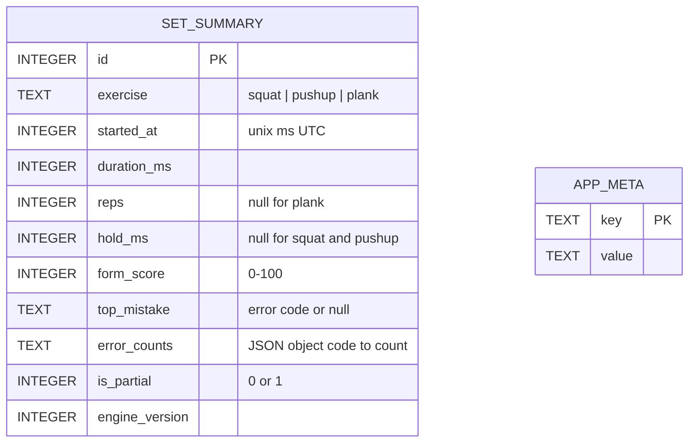

# Data model: Pose Coach v1

Inputs: `spec.md` (R12-R14, AC9), `grill.md` Q6, Q8, `architecture.md`.
The data is a small list of "set summaries" in a SQLite file (a single-file database) on the phone, via `expo-sqlite`. There is no server, no account, and no image or video is ever stored (R4, R14). New product, so there is no current schema.

## Entities

Both tables are new. No relation between them: `app_meta` holds settings such as "medical note shown" and `schema_version`. Per-error counts are kept as a small JSON text in one column instead of a second table (see Decisions).

## Tables
### set_summary (new)
| Column | Type | Null | Default | Key / constraint |
| --- | --- | --- | --- | --- |
| id | INTEGER | no | auto | PRIMARY KEY AUTOINCREMENT |
| exercise | TEXT | no | | CHECK in ('squat','pushup','plank') |
| started_at | INTEGER | no | | unix milliseconds, UTC |
| duration_ms | INTEGER | no | | CHECK >= 0 |
| reps | INTEGER | yes | NULL | CHECK >= 0; required for squat and pushup |
| hold_ms | INTEGER | yes | NULL | CHECK >= 0; required for plank (time with correct form) |
| form_score | INTEGER | no | | CHECK between 0 and 100 (share of reps, or of hold time, with correct form) |
| top_mistake | TEXT | yes | NULL | error code such as `knees_in`; NULL when the set had none |
| error_counts | TEXT | no | '{}' | JSON object, error code -> number of reps (or seconds) affected |
| is_partial | INTEGER | no | 0 | 1 when ended by leaving frame, background or crash recovery |
| engine_version | INTEGER | no | 1 | version of the rules, so old scores are not compared blindly |
A table-level CHECK makes sure exactly one of `reps` / `hold_ms` is filled, matching the exercise. Texts shown to the user (Vietnamese mistake names) are not stored: only codes, so language can change later.

### app_meta (new)
| Column | Type | Null | Default | Key / constraint |
| --- | --- | --- | --- | --- |
| key | TEXT | no | | PRIMARY KEY (`schema_version`, `disclaimer_seen`) |
| value | TEXT | no | | |

## Diff vs current schema
Added: `set_summary`, `app_meta`, index `idx_set_started_at`. Changed: none. Removed: none.

## Indexes and query patterns
| Query pattern | Index | Write cost |
| --- | --- | --- |
| History list, newest first (R13): `ORDER BY started_at DESC LIMIT 50 OFFSET ?` | `idx_set_started_at` on `started_at` (DESC) | One extra small write per set (a few per day); negligible |
| History filtered by exercise (future screen filter) | Not now; add `(exercise, started_at DESC)` only if the filter ships | n/a |
| Open one summary by id | Primary key | none |
Even 10,000 sets is only a few hundred KB, so no other tuning is needed.

## Migration, backfill, rollback
Approach: a number `PRAGMA user_version` holds the schema version (0 = empty). On app start, `storage` runs numbered migration steps in order until it reaches the latest, each in one transaction.
1. v0 -> v1 (first release): create `set_summary`, `idx_set_started_at`, `app_meta`; set `user_version = 1`.
2. Future changes follow "expand then contract": add new nullable columns or tables first (old app builds still work), backfill in batches of 500 rows, remove old columns only in a later release.
3. Before any migration that changes existing rows, copy the database file to `pose-coach.db.bak` (a local file on the phone, same privacy class). Delete the copy after the next successful start.
4. If a migration fails, its transaction rolls back, the app opens read-only History with a message, and the `.bak` file is restored on next start.
Rollback: v1 has nothing to roll back (empty start). For later versions, an app downgrade cannot undo a migration, so each release must keep reading the previous schema version (columns are only added). Destructive steps (dropping a column or table) are **Hard to change later** and need Hoan's explicit ok.
Upgrade data safety: the database file stays when the app is updated; it is removed only if the user uninstalls the app (history is lost then; no cloud copy by design).

## PII, retention, access
| Data | Class | Retention | Access |
| --- | --- | --- | --- |
| Set summaries (exercise, time, counts, score) | Personal health-adjacent activity data, on device only | Kept until the user deletes it or uninstalls; no automatic expiry | App only (OS app sandbox); never sent anywhere |
| `app_meta` | Not personal | Same | App only |
| Camera frames, video, pose points | Never stored | Memory only, discarded within the frame | n/a |
Encryption: rely on the phone's own file encryption; no extra database encryption in v1. A "delete all history" button is recommended in Settings or History (small, supports user control).

## Decisions
| Decision | Recommended | Reason and trade-off | Hard to change later |
| --- | --- | --- | --- |
| Database engine | SQLite via expo-sqlite | Standard, offline, supports later queries; heavier than a simple key-value file but safer to extend | Yes |
| One table for sets, JSON text for per-error counts | Yes | Simple and enough: counts are only read together with their set. Trade-off: cannot cheaply ask "total of error X across all sets" (add a table later if wanted) | Medium |
| Store codes, not Vietnamese text | Yes | English can be added without migrating data | No |
| Time stored as UTC unix milliseconds | Yes | No time-zone bugs; display converts to local time | Medium |
| Save partial sets (flag) | Yes, if at least 1 rep or 5 s hold | Fewer lost workouts; flag lets History mark them | No |
| Versioning with `PRAGMA user_version` + numbered steps | Yes | Built into SQLite, no extra library | Medium |
| Delete-all-history button | Yes | Gives control over data; tiny extra screen work | No |
| Form score formula | Reps with no error / total reps x 100 (plank: correct-form time / total time x 100), rounded | Matches spec R12 wording; the engine computes it and stores `engine_version` | No |

## Open questions
- None blocking. To settle in `frontend-design`: whether History allows deleting single sets. Recommended: only "delete all" in v1, to keep the screen simple.
